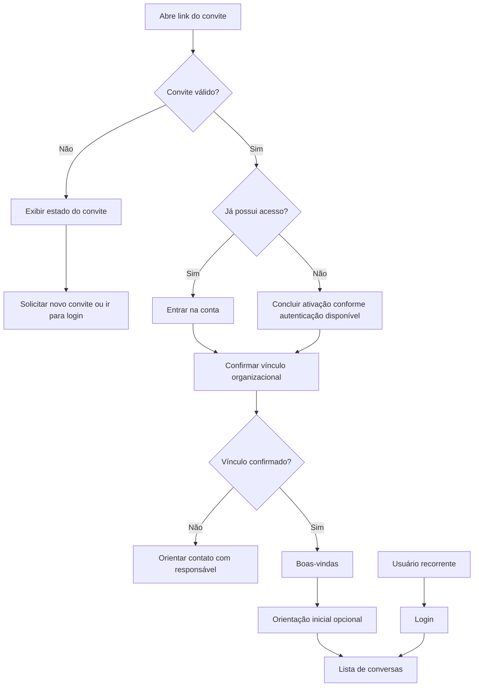

# Issue #71 — Onboarding e primeiro acesso de colaboradores

**Status:** Especificação de UX/UI concluída; fluxo e telas descritos para prototipação e implementação.  
**Objetivo:** conduzir o colaborador do convite ou login até compreender seu vínculo organizacional e localizar suas conversas, sem criar barreiras desnecessárias.

## 1. Princípios da experiência

- O usuário deve saber em que etapa está e qual é a próxima ação.
- Solicitar apenas dados necessários para autenticação e identificação.
- Não permitir que o usuário altere por conta própria empresa, unidade ou permissões atribuídas administrativamente.
- Explicar erros e oferecer recuperação.
- A orientação inicial deve ser curta, contextual e dispensável.
- O onboarding não deve reaparecer a cada login depois de concluído, salvo se o usuário solicitar ajuda.

## 2. Arquitetura do fluxo

O produto terá duas entradas:

1. **Primeiro acesso por convite:** convite recebido → validação → autenticação ou criação/ativação de acesso conforme mecanismo existente → confirmação do vínculo → boas-vindas → orientação inicial → conversas.
2. **Acesso de usuário recorrente:** login → autenticação → conversas. Não exibir novamente o onboarding concluído.

O convite não concede permissões além das já associadas à conta e à organização. O usuário não escolhe seu próprio papel ou nível de acesso.

### Diagrama do fluxo

## 3. Telas do fluxo — especificação de interface

### Tela 01 — Convite recebido

**Objetivo:** explicar por que a pessoa está acessando a plataforma e permitir continuar.

**Conteúdo**
- Título: “Você foi convidado para o CallZUP”
- Texto: “Seu acesso está associado à organização {nome_organizacao}. Continue para entrar na plataforma.”
- Informação complementar: “Se você não esperava este convite, não continue e procure o responsável pelo seu acesso.”
- Ação primária: “Aceitar convite”
- Ação secundária: “Já tenho uma conta”

**Comportamento**
- Exibir o nome da organização apenas quando vier do convite validado.
- Não revelar informações de equipe, conversas ou outros colaboradores antes da autenticação.
- Link “Já tenho uma conta” direciona para login preservando o contexto do convite, se tecnicamente suportado.

### Tela 02 — Validar convite

A validação ocorre antes de mostrar dados privados.

| Estado | Título | Mensagem | Ação |
|---|---|---|---|
| Validando | Verificando seu convite… | Estamos conferindo se o link ainda pode ser utilizado. | Indicador de progresso |
| Válido | Convite confirmado | Seu convite está válido. Continue para acessar o CallZUP. | Continuar |
| Expirado | Este convite expirou | Peça ao responsável pela sua equipe que envie um novo convite. | Voltar ao login |
| Já utilizado | Este convite já foi utilizado | Entre com a conta associada a este convite. | Fazer login |
| Inválido | Não foi possível validar o convite | Confira se o link está completo ou solicite um novo convite ao responsável. | Voltar |
| Revogado | Este convite não está mais ativo | Peça ao responsável pelo seu acesso que verifique o convite. | Voltar ao login |
| Falha temporária | Não foi possível verificar agora | Tente novamente em instantes. | Tentar novamente |

Não distinguir causas internas sensíveis quando isso puder facilitar enumeração de contas. A tela não deve exibir token ou identificador secreto do convite.

### Tela 03 — Autenticação / ativação

**Objetivo:** encaminhar o usuário ao mecanismo de autenticação já adotado pelo produto.

**Regras de UX**
- Reutilizar os componentes e padrões da experiência de autenticação principal (#39).
- Não inventar um segundo mecanismo de senha ou cadastro paralelo.
- Se o sistema exigir criação de credencial, mostrar requisitos antes do envio e orientar erros junto ao campo.
- Se a conta já existir, oferecer login em vez de tentar criar uma conta duplicada.
- Não pedir empresa, unidade, cargo ou permissões novamente se esses dados já vierem do vínculo administrativo.

**Mensagens**
- Campo obrigatório: “Preencha este campo para continuar.”
- Credencial inválida: “Não foi possível entrar com esses dados. Confira as informações e tente novamente.”
- Falha temporária: “Não foi possível concluir o acesso agora. Tente novamente.”
- Recuperação: “Esqueceu sua senha?” (somente se esse recurso existir no fluxo de autenticação).

### Tela 04 — Confirmação do vínculo organizacional

**Objetivo:** dar transparência sobre o contexto de trabalho associado ao acesso.

**Conteúdo**
- Título: “Seu acesso está vinculado a”
- Organização: “{nome_organizacao}”
- Unidade: “{nome_unidade}” (somente se existir e estiver atribuída)
- Equipe: “{nome_equipe}” (somente se existir e estiver atribuída)
- Texto: “Essas informações foram definidas para seu acesso.”
- Ação: “Continuar”

**Exceções**
- Unidade ou equipe não atribuída: não exibir campo vazio; informar apenas a organização.
- Vínculo incorreto: “Essas informações não parecem corretas? Procure o responsável pelo seu acesso.”
- Vínculo não confirmado: “Não foi possível confirmar seu vínculo. Peça ao responsável pela organização que verifique seu acesso.”
- Não oferecer edição de vínculo nessa etapa, a menos que exista fluxo administrativo autorizado.

### Tela 05 — Boas-vindas

**Conteúdo**
- Título: “Bem-vindo ao CallZUP”
- Texto: “Use o CallZUP para acompanhar conversas e informações da sua operação em um só lugar.”
- Ação primária: “Conhecer o ambiente”
- Ação secundária: “Ir para conversas”

O usuário pode pular a apresentação e acessar diretamente as conversas.

### Tela 06 — Orientação inicial

Apresentar no máximo três dicas curtas, em sequência ou como destaques sobre a interface:

1. **Suas conversas:** “Acesse aqui as conversas das quais você participa.”
2. **Mensagens:** “Abra uma conversa para acompanhar as mensagens e enviar atualizações.”
3. **Busca:** “Use a busca para localizar conversas ou mensagens disponíveis para você.”

A dica de busca só deve aparecer se a busca estiver implementada e disponível ao usuário.

**Controles**
- “Próxima dica”
- “Voltar”
- “Pular”
- “Concluir”

Persistir a conclusão do onboarding para não repetir em acessos seguintes. Se não houver persistência disponível, não bloquear o acesso: permitir fechar a orientação.

### Tela 07 — Primeiro acesso à lista de conversas

**Estado com conversas**
- Título: “Suas conversas”
- Texto auxiliar: “Acompanhe as conversas disponíveis para você.”
- Abrir uma conversa leva à tela de mensagens.

**Estado sem conversas**
- Título: “Você ainda não participa de conversas”
- Texto: “Quando uma conversa for disponibilizada para você, ela aparecerá aqui.”
- Não exibir botão “Criar conversa” se o usuário não tiver essa permissão.

## 4. Fluxo de usuário recorrente

1. Usuário abre o CallZUP.
2. Informa credenciais ou utiliza o método de autenticação existente.
3. Sistema valida o acesso.
4. Usuário é direcionado à lista de conversas.
5. Se a sessão estiver expirada, mostrar orientação para entrar novamente.
6. Não exibir convite, confirmação de organização ou tutorial já concluído novamente.

## 5. Matriz de estados e recuperação

| Cenário | Resposta da interface | Recuperação |
|---|---|---|
| Link incompleto | Não foi possível validar o convite | Solicitar novo link |
| Convite expirado | Este convite expirou | Solicitar novo convite |
| Convite revogado | Este convite não está mais ativo | Contatar responsável |
| Convite já utilizado | Este convite já foi utilizado | Fazer login |
| Conta já existente | Você já tem uma conta | Entrar na conta |
| Falha de autenticação | Não foi possível entrar com esses dados | Corrigir e tentar novamente |
| Vínculo ausente | Seu acesso ainda não está associado a uma organização | Contatar responsável |
| Sem unidade/equipe atribuída | Exibir apenas os dados existentes | Continuar sem bloquear |
| Sem conversas | Você ainda não participa de conversas | Aguardar disponibilização |
| Sessão expirada | Sua sessão expirou por segurança | Entrar novamente |
| Falha de rede | Sem conexão. Verifique sua rede e tente novamente. | Tentar novamente |

## 6. Regras de permissão e privacidade

- O convite identifica o contexto de entrada, mas não deve ser tratado como prova suficiente de autorização após seu uso.
- A autorização deve ser verificada pelo sistema em cada recurso protegido.
- O onboarding só apresenta informações que a conta autenticada pode visualizar.
- Não mostrar nomes de equipes, unidades ou pessoas antes da autenticação.
- Não permitir autoatribuição de papel, unidade ou equipe.
- Não indicar que o usuário tem acesso a uma conversa antes de o sistema confirmar essa permissão.
- Não revelar se um e-mail está cadastrado em mensagens públicas de erro; usar mensagens neutras quando necessário.
- A opção de sair ou cancelar deve estar disponível sem apagar dados da conta.

## 7. Adaptação responsiva

### Desktop
- Conteúdo centralizado em coluna de largura confortável.
- Etapas e progresso visíveis sem ocupar a área principal.
- Informações organizacionais agrupadas em um painel.
- Ações primárias e secundárias claramente separadas.

### Tablet
- Layout em uma coluna quando a largura não comportar duas áreas.
- Botões com área de toque adequada.
- Evitar modais estreitos ou formulários com rolagem horizontal.

### Celular
- Uma única coluna.
- Botão principal ocupando a largura disponível.
- Texto e erros sem truncamento.
- Campos com rótulos persistentes e teclado apropriado.
- Ações secundárias acessíveis sem competir visualmente com a ação principal.
- Não exigir hover para descobrir instruções ou ações.

## 8. Acessibilidade

- Ordem de foco acompanha a ordem visual e lógica.
- Títulos identificam claramente cada etapa.
- Erros são associados aos campos e anunciados por leitores de tela.
- Indicadores de progresso têm rótulo textual.
- Contraste, tamanho de texto e área de toque seguem os padrões de acessibilidade adotados pelo produto.
- Nenhum estado é comunicado somente por cor.
- O usuário pode avançar, voltar ou pular a apresentação sem depender de gesto complexo.

## 9. Critérios de aceite da entrega UX/UI

- [x] Fluxo de primeiro acesso por convite documentado.
- [x] Caminho de login para usuário recorrente documentado.
- [x] Estados de convite válido, expirado, utilizado, inválido e revogado especificados.
- [x] Telas e conteúdo principal descritos em nível de wireframe textual.
- [x] Vínculo organizacional contemplado sem permitir autoatribuição de permissões.
- [x] Orientação inicial curta, opcional e dispensável definida.
- [x] Estados vazios, falhas e caminhos de recuperação documentados.
- [x] Regras de responsividade e acessibilidade registradas.
- [x] Relação com autenticação (#39) e perfil (#40) explicitada.

## 10. Diretrizes para implementação

- Reutilizar autenticação, cadastro e perfil existentes; este documento não substitui as regras técnicas dessas funcionalidades.
- O backend deve ser a fonte de verdade para validade do convite, vínculo e permissões.
- Estados de convite devem ser apresentados com base em respostas explícitas do serviço.
- O tutorial deve ser curto e sua conclusão persistida quando houver suporte.
- Todas as telas devem prever carregamento, erro e tentativa novamente quando aplicável.
- Não criar telas ou campos para funcionalidades que o produto não oferece.
- Usar os textos padronizados no documento `02-microcopy.md`.

## 11. Resultado

Especificação de onboarding com fluxo principal, fluxos alternativos, wireframes textuais, conteúdo de interface, regras de permissão, recuperação de erros, responsividade e acessibilidade. O material está organizado para ser convertido em protótipo visual e orientar o frontend, respeitando os mecanismos de autenticação e autorização existentes no CallZUP.
