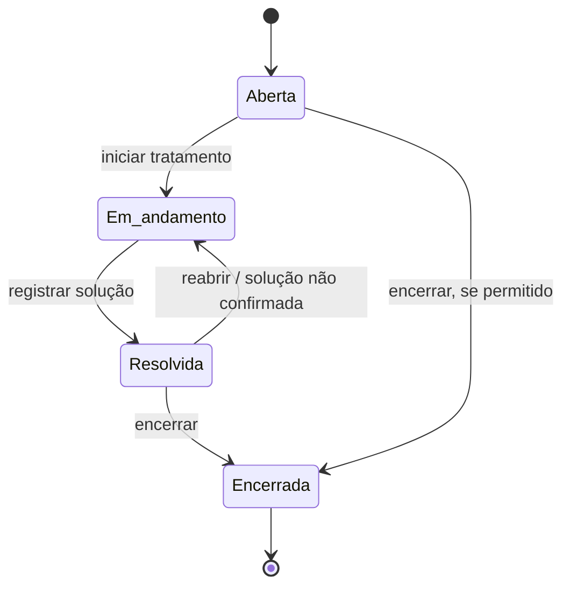

# Issue #73 — Detalhes e ciclo de vida de ocorrências operacionais

**Entrega UX/UI:** especificação funcional de interface e protótipo navegável.  
**Objetivo:** permitir que colaboradores consultem uma ocorrência, entendam sua situação, identifiquem responsáveis, acompanhem atualizações e acessem a conversa relacionada.

> **Nota de escopo:** os status, campos e ações abaixo constituem uma proposta de experiência. Devem ser mapeados para os valores e permissões efetivamente suportados pelo produto. O protótipo usa dados fictícios e não grava alterações no backend.

## 1. Objetivos da experiência

- Tornar a situação atual visível sem obrigar o usuário a ler todo o histórico.
- Explicar o que aconteceu, onde, quando e quem está acompanhando.
- Distinguir dados atuais de eventos passados.
- Permitir localizar a conversa relacionada sem perder o contexto.
- Dar feedback claro ao registrar atualizações.
- Tratar falta de permissão, informação incompleta, indisponibilidade e encerramento.
- Evitar que ações destrutivas ou mudanças de status sejam apresentadas a quem não tem autorização.

## 2. Modelo de informação da ocorrência

| Campo | Exibição | Regra de UX |
|---|---|---|
| Identificador | OC-204 | Código curto e copiável; valor real vem do sistema |
| Título | Atraso na coleta — Unidade Salvador | Resumo objetivo |
| Descrição | Relato detalhado da situação | Preservar texto original e quebras de linha |
| Status | Aberta / Em andamento / Resolvida / Encerrada | Destacar com texto e indicador visual |
| Prioridade | Baixa / Média / Alta / Urgente | Usar rótulo textual; não depender de cor |
| Unidade / área | Unidade Salvador | Ocultar se não existir ou não houver acesso |
| Local | Endereço ou ponto operacional | Mostrar apenas se fornecido e autorizado |
| Responsável | Nome e avatar, se disponíveis | Indicar “Não atribuído” quando aplicável |
| Criada por | Nome do autor | Mostrar conforme política de privacidade |
| Criada em | Data e hora localizadas | Usar formato regional |
| Atualizada em | Data e hora da última mudança | Não confundir com data de criação |
| Conversa relacionada | Nome/link da conversa | Abrir apenas após verificar permissão |
| Anexos | Arquivos relacionados | Exibir metadados e ações autorizadas |
| Histórico | Eventos ordenados cronologicamente | Cada evento tem autor, data/hora e descrição |

Campos opcionais não devem gerar espaços vazios ou rótulos sem valor. Não inventar endereço, unidade, responsável ou anexos para preencher a tela.

## 3. Estrutura da tela de detalhes

### Cabeçalho
- Breadcrumb: “Ocorrências / OC-204”.
- Título da ocorrência.
- Identificador com ação “Copiar código”.
- Status atual em destaque.
- Ações secundárias: “Abrir conversa” (quando disponível) e menu de ações permitidas.

### Resumo operacional
Exibir em primeiro plano:
- Status.
- Prioridade.
- Responsável.
- Unidade / área.
- Data de abertura.
- Última atualização.

### Descrição
- Texto integral da ocorrência.
- Não truncar conteúdo sem oferecer “Ver mais”.
- Preservar links e quebras de linha de forma segura.

### Atualização
Campo “Adicionar atualização” para registrar comentário ou informação relevante, se a funcionalidade e a permissão existirem.
- Placeholder: “Descreva o que mudou ou adicione uma informação relevante.”
- Botão: “Registrar atualização”.
- Estados: vazio, digitando, enviando, enviado e falha.
- Não alterar status implicitamente ao registrar comentário.

### Histórico
Linha do tempo com:
- Evento.
- Autor.
- Data e horário.
- Status anterior e novo status, quando for mudança.
- Comentário associado, quando houver.

Ordenação padrão: mais recente primeiro, com opção de consultar eventos anteriores se houver paginação.

### Conversa relacionada
Card com nome da conversa e texto “Acompanhe as mensagens relacionadas a esta ocorrência”.
A ação “Abrir conversa” só aparece se houver conversa vinculada e acesso autorizado.

## 4. Ciclo de vida proposto

Estados conceituais para organizar a experiência:

| Status | Significado | Apresentação |
|---|---|---|
| Aberta | Registrada e aguardando tratamento | Estado inicial |
| Em andamento | Em análise ou tratamento | Trabalho iniciado |
| Resolvida | Solução registrada, aguardando eventual confirmação se o processo exigir | Solução indicada |
| Encerrada | Ciclo finalizado conforme regra do produto | Estado final |

### Transições sugeridas para desenho



Este diagrama não determina a regra de negócio. O backend deve informar quais transições são válidas. Não mostrar opções inválidas e não permitir que a interface invente uma transição.

### Confirmação de mudança
Ao solicitar uma mudança:
- Mostrar status atual e status pretendido.
- Explicar a consequência em linguagem simples.
- Oferecer “Cancelar” e ação específica, como “Marcar como em andamento”.
- Se houver campo obrigatório de justificativa, apresentá-lo antes da confirmação.
- Atualizar o status visual apenas após confirmação do servidor.

## 5. Prioridade

Proposta de rótulos:
- **Baixa:** pode aguardar a fila normal.
- **Média:** requer acompanhamento dentro do fluxo regular.
- **Alta:** requer atenção prioritária.
- **Urgente:** exige atenção imediata conforme processo operacional.

A definição de SLA, escalonamento e impacto operacional não é determinada por UX. Não associar cores a prazos ou garantias não estabelecidos.

## 6. Ações e permissões

| Ação | Usuário leitor | Responsável / operador autorizado | Gestor autorizado |
|---|---:|---:|---:|
| Consultar detalhes | Conforme acesso | Sim | Sim |
| Consultar histórico | Conforme acesso | Sim | Sim |
| Abrir conversa relacionada | Se tiver acesso à conversa | Se tiver acesso | Se tiver acesso |
| Registrar atualização | Não, salvo permissão | Conforme regra | Conforme regra |
| Alterar status | Não, salvo permissão | Conforme regra | Conforme regra |
| Alterar responsável | Não, salvo permissão | Conforme regra | Conforme regra |
| Alterar prioridade | Não, salvo permissão | Conforme regra | Conforme regra |
| Encerrar / reabrir | Não, salvo permissão | Conforme regra | Conforme regra |

A matriz é um modelo para discutir autorização, não uma afirmação sobre os papéis já implementados. A API é a fonte de verdade. Ocultar ou desabilitar uma ação na interface não substitui a validação de permissão no servidor.

## 7. Estados de interface

| Estado | Conteúdo | Ação |
|---|---|---|
| Carregando | Skeleton dos blocos e “Carregando ocorrência…” | Nenhuma ação de edição |
| Completo | Todos os dados disponíveis | Ações autorizadas |
| Informação parcial | Exibir somente os dados existentes | Não inventar campos |
| Sem responsável | “Nenhum responsável atribuído” | Ação de atribuição somente se permitida |
| Sem histórico | “Ainda não há atualizações registradas.” | Manter resumo visível |
| Sem conversa | “Nenhuma conversa relacionada.” | Não mostrar link inativo |
| Não encontrada | “Não foi possível encontrar esta ocorrência.” | “Voltar para ocorrências” |
| Sem permissão | “Você não tem permissão para acessar esta ocorrência.” | “Voltar” |
| Encerrada | Badge textual “Encerrada” e histórico disponível | Não oferecer edição incompatível |
| Falha de carregamento | “Não foi possível carregar os detalhes. Tente novamente.” | “Tentar novamente” |
| Atualização enviada | “Atualização registrada.” | Limpar campo após confirmação |
| Falha ao atualizar | “Não foi possível registrar a atualização. Tente novamente.” | Preservar texto digitado |
| Falha ao mudar status | “Não foi possível atualizar o status. A ocorrência permanece como {status_atual}.” | Tentar novamente |

## 8. Conteúdo de interface (microcopy)

### Ações
- “Copiar código”
- “Abrir conversa”
- “Adicionar atualização”
- “Registrar atualização”
- “Alterar status”
- “Alterar responsável”
- “Alterar prioridade”
- “Ver histórico completo”
- “Voltar para ocorrências”

### Confirmações
**Marcar como em andamento**
- Título: “Iniciar tratamento desta ocorrência?”
- Texto: “O status será atualizado para Em andamento.”
- Ações: “Cancelar” / “Marcar como em andamento”.

**Marcar como resolvida**
- Título: “Marcar ocorrência como resolvida?”
- Texto: “Registre a solução antes de concluir esta etapa.”
- Ações: “Cancelar” / “Marcar como resolvida”.

**Encerrar**
- Título: “Encerrar ocorrência?”
- Texto: “A ocorrência será marcada como encerrada. A disponibilidade de novas alterações seguirá as permissões do produto.”
- Ações: “Cancelar” / “Encerrar ocorrência”.

**Reabrir**
- Título: “Reabrir ocorrência?”
- Texto: “A ocorrência voltará para acompanhamento.”
- Ações: “Cancelar” / “Reabrir ocorrência”.

### Erros
- “Não foi possível carregar os detalhes. Tente novamente.”
- “Você não tem permissão para realizar esta ação.”
- “Esta ocorrência foi atualizada por outra pessoa. Atualize a tela para ver a versão mais recente.”
- “Escreva uma atualização antes de enviar.”
- “Não foi possível registrar a atualização. Seu texto foi mantido para você tentar novamente.”
- “Esta ocorrência não está mais disponível.”

## 9. Wireframe textual — desktop

```text
┌──────────────────────────────────────────────────────────────────────────────┐
│ Ocorrências / OC-204                                      [Abrir conversa]  │
│ Atraso na coleta — Unidade Salvador                     [••• Ações]         │
│ [EM ANDAMENTO]  Prioridade: Alta                                           │
├──────────────────────────────────────────────────────────────────────────────┤
│ RESUMO                                                                       │
│ Responsável       Unidade             Criada em            Atualizada em     │
│ Marina Santos     Salvador            25/11/2026 08:20     25/11/2026 10:42  │
├─────────────────────────────────────────────┬────────────────────────────────┤
│ DESCRIÇÃO                                   │ ACOMPANHAMENTO                 │
│ Coleta prevista não ocorreu no horário...   │ Status: Em andamento          │
│                                             │ Prioridade: Alta               │
│ ATUALIZAÇÃO                                 │ Responsável: Marina Santos     │
│ [Descreva o que mudou...]                   │                                │
│ [Registrar atualização]                     │ CONVERSA RELACIONADA           │
│                                             │ Operação Salvador [Abrir]      │
│ HISTÓRICO                                   │                                │
│ ● 10:42 Marina — Em andamento               │                                │
│   Iniciada análise com transportadora.      │                                │
│ ● 08:20 João — Ocorrência aberta            │
│   Coleta não realizada no horário previsto.│
└─────────────────────────────────────────────┴────────────────────────────────┘
```

## 10. Comportamento responsivo

### Desktop
- Duas colunas: conteúdo e histórico na área principal; resumo e ações contextuais em coluna lateral.
- Cabeçalho com status e ações.
- Linha do tempo com boa separação entre eventos.

### Tablet
- Priorizar uma coluna quando o espaço lateral ficar estreito.
- Resumo em grade de duas colunas.
- Ações em menu identificado, sem depender de hover.

### Celular
- Uma coluna e ordem: cabeçalho/status → resumo → descrição → atualização → histórico → conversa.
- Ações principais acessíveis sem rolagem excessiva.
- Histórico em linha do tempo vertical.
- Campos e botões com largura confortável.
- Tabelas devem virar blocos ou listas; sem rolagem horizontal obrigatória.
- Não esconder status ou prioridade em menus.

## 11. Acessibilidade

- Status e prioridade têm rótulo textual.
- Mudanças de status e confirmação de envio são anunciadas por tecnologia assistiva.
- A linha do tempo tem estrutura semântica e ordem cronológica compreensível.
- Botões de ícone possuem nome acessível.
- Erros ficam associados ao campo correspondente.
- Foco retorna a um local previsível após modal fechar.
- Não comunicar prioridade ou status somente por cor.
- Suportar navegação por teclado, zoom e leitores de tela.

## 12. Privacidade e integridade dos dados

- Consultar autorização no servidor para cada ocorrência e recurso relacionado.
- Não exibir dados de outra unidade ou equipe sem permissão.
- Não revelar nomes de participantes em contexto não autorizado.
- Histórico deve ser append-only do ponto de vista da experiência: não simular que eventos passados foram apagados ou reescritos.
- Registrar autor e data/hora das alterações quando a plataforma fornecer esses dados.
- Em conflito de edição, informar que os dados mudaram e solicitar atualização da tela.
- Não atualizar status otimisticamente sem estratégia de reversão em caso de falha.

## 13. Critérios de aceite UX/UI

- [x] Estrutura da tela de detalhes documentada com hierarquia de informação.
- [x] Campos obrigatórios e opcionais diferenciados.
- [x] Ciclo de vida proposto e transições representadas.
- [x] Ações e matriz conceitual de permissões documentadas.
- [x] Histórico com autoria, data/hora e mudanças de status especificado.
- [x] Estados vazio, parcial, carregamento, erro, sem permissão e encerrado documentados.
- [x] Conteúdo de interface e confirmações definidos.
- [x] Layout desktop, tablet e celular descrito.
- [x] Acessibilidade, privacidade e integridade consideradas.
- [x] Protótipo navegável incluído como demonstração de interação.
- [x] Relação com a listagem #45 e conversas #32 explicitada.

## 14. Diretrizes para frontend

1. Consumir os campos efetivamente fornecidos pela API.
2. Mapear status reais para rótulos e estilos visuais centralizados.
3. Consultar permissões antes de apresentar ações e validar novamente no servidor.
4. Não permitir transições fora da máquina de estados retornada pela API.
5. Preservar texto da atualização em caso de falha.
6. Registrar histórico após confirmação do serviço.
7. Tratar estados de carregamento, erro e dados parciais.
8. Usar identificador da ocorrência em links e breadcrumb.
9. Verificar autorização ao navegar para a conversa relacionada.
10. Centralizar microcopy conforme `02-microcopy.md`.
11. Em conflitos, atualizar dados e explicar ao usuário o que ocorreu.
12. Não usar dados fictícios do protótipo em produção.

## 15. Resultado

Especificação de UX/UI pronta para prototipação e implementação, acompanhada de protótipo HTML navegável com dados fictícios. O material demonstra a hierarquia dos detalhes, ações contextuais, histórico, atualização de ocorrência e estados de ciclo de vida, sem substituir as regras de negócio ou integrações do backend.